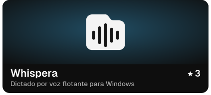
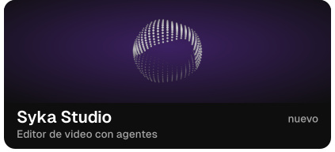
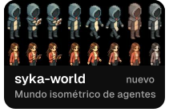
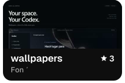
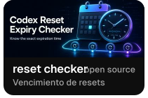

&nbsp;&nbsp;&nbsp;

Mi actividad en GitHub, devorada por una serpiente

<picture>
  <source media="(prefers-color-scheme: dark)" srcset="https://raw.githubusercontent.com/SikJa/Sikja/output/github-contribution-grid-snake-dark.svg">
  <source media="(prefers-color-scheme: light)" srcset="https://raw.githubusercontent.com/SikJa/Sikja/output/github-contribution-grid-snake.svg">
  
</picture>

